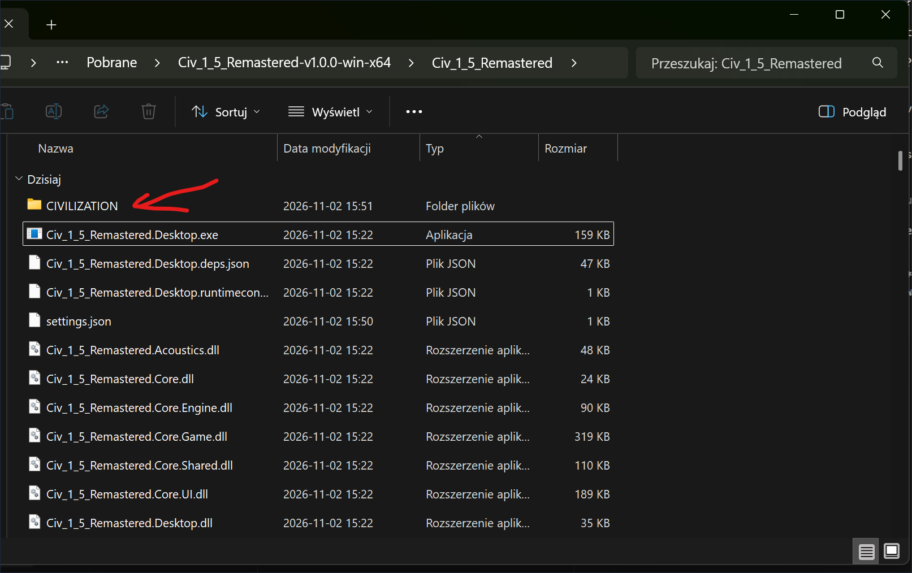
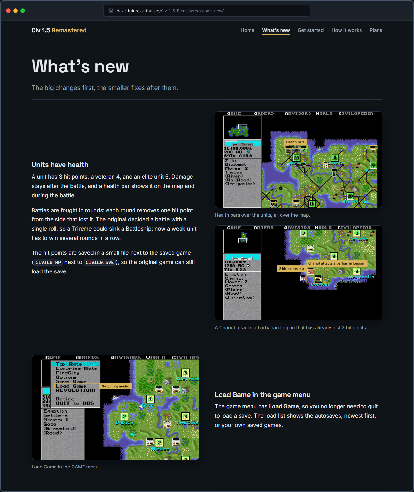

# Civ 1.5 Remastered

**To play:** unpack the [latest release](https://github.com/DavIT-Futures/Civ_1_5_Remastered/releases), put the
`CIVILIZATION` folder next to `Civ_1_5_Remastered.Desktop.exe` and run it. The `CIVILIZATION` folder is the original
Civilization 1 for DOS from 1991. It is not part of this project, but it is easy to find online, for example on the
Internet Archive: [search for "CIVILIZATION.zip Civilization 1991 DOS"](https://www.google.com/search?q=CIVILIZATION.zip+Civilization+1991+DOS+archive.org).

**No DOSBox and no installation needed:** just copy the game folder next to the program, as in the picture above.

**[What's new](https://davit-futures.github.io/Civ_1_5_Remastered/whats-new/)**: the full list of changes, with screenshots.
Plans and how it works: [the project website](https://davit-futures.github.io/Civ_1_5_Remastered/).

A C# remaster of Civilization (1991) for DOS. The original `CIV.EXE` is translated function by function into C#, so
the game plays like it did in 1991, with the rough edges fixed:

- **Unit health:** units have hit points and health bars, and battles are fought in rounds, so a weak unit no longer
  destroys a much stronger one in one roll.
- **Healing:** damaged units heal every turn, in cities, fortified, or resting near the coast.
- **Railroads:** cities have railroads, and moves along railroads are free also with GoTo.
- **Saves:** 10 save slots instead of 4, and 20 autosaves made every turn instead of 4 made every 1000 years.
- **Load Game** right in the game menu.
- **Upgrade units for gold:** in a city, an old unit becomes its successor (Phalanx into Musketeers, Knights into
  Armor, Cruiser into Battleship), keeping its veteran rank and its damage.
- **Wonders never become obsolete:** every Wonder of the World works for as long as you hold its city.

## Play

1. [Download the latest version](https://github.com/DavIT-Futures/Civ_1_5_Remastered/releases/latest/download/Civ_1_5_Remastered-win-x64.zip) and unpack it.
2. Put the files of Civilization 1 for DOS in a folder named `CIVILIZATION` next to `Civ_1_5_Remastered.Desktop.exe`.
   The game files are not part of this repository; to find a copy, search for
   [CIVILIZATION.zip Civilization 1991 DOS](https://www.google.com/search?q=CIVILIZATION.zip+Civilization+1991+DOS+archive.org).
3. Run `Civ_1_5_Remastered.Desktop.exe`.

## Legal

Civ 1.5 Remastered is an unofficial fan project. It is not affiliated with or endorsed by MicroProse, Firaxis Games or
Take-Two Interactive. Civilization is a trademark of its owners. This repository contains no files of the original
game. The code is under the MIT license, see `LICENSE`.
