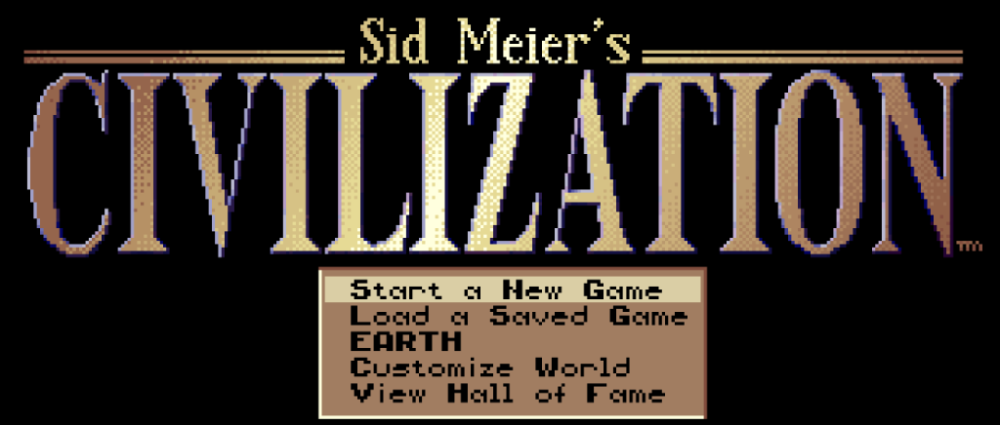
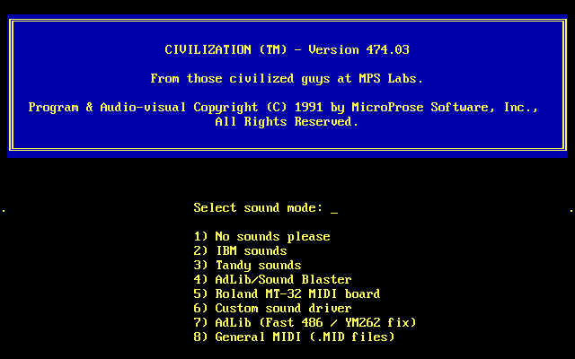

# Civ 1.5 Remastered

  

[English](README.md) | **Polski**

**Aby zagrać:** rozpakuj [najnowsze wydanie](https://github.com/DavIT-Futures/Civ_1_5_Remastered/releases), umieść folder
`CIVILIZATION` obok `Civ_1_5_Remastered.Desktop.exe` (lub `Civ_1_5_Remastered.Desktop` na Linux/macOS) i uruchom grę. Folder `CIVILIZATION` to oryginalna
gra Civilization 1 dla DOS z 1991 roku. Nie jest częścią tego projektu, ale można ją łatwo znaleźć w sieci, na przykład na
Internet Archive: [wyszukaj "CIVILIZATION.zip Civilization 1991 DOS"](https://www.google.com/search?q=CIVILIZATION.zip+Civilization+1991+DOS+archive.org).

**Bez DOSBoksa i bez instalacji:** po prostu skopiuj folder z oryginalną grą obok programu, jak na zrzucie ekranu powyżej.

**[Co nowego](https://davit-futures.github.io/Civ_1_5_Remastered/pl/whats-new/)**: pełna lista zmian ze zrzutami ekranu.
Architektura dźwięku i sterowniki audio: [Dźwięk i muzyka](https://davit-futures.github.io/Civ_1_5_Remastered/pl/sound/).
Plany oraz opis działania: [strona internetowa projektu](https://davit-futures.github.io/Civ_1_5_Remastered/pl/).

Remaster w C# gry Civilization (1991) z DOS. Oryginalny plik `CIV.EXE` został przetłumaczony funkcja po funkcji na C#, dzięki czemu
gra działa dokładnie tak jak w 1991 roku, ale z usuniętymi mankamentami i uciążliwościami:

- **Autentyczne ekrany startowe DOS i konfiguracja dźwięku:** wybór grafiki, sterowania i 8 trybów audio z wierną czcionką IBM PC ROM BIOS, łatką MicroProse dla 486/YM262 (ASOUND2/3) oraz natywnym odtwarzaniem 18 plików General MIDI (.MID).
- **Przywrócony dźwięk Tandy 1000:** napisany od zera, precyzyjny emulator układu Texas Instruments SN76496 (3 kanały fali prostokątnej, 1 kanał szumu LFSR, 16 poziomów głośności), przywracający 3-głosową polifonię Tandy 1000.
- **Roland MT-32 tłumaczony do General MIDI:** autorski translator MIDI w czasie rzeczywistym mapuje barwy MT-32 i perkusję SysEx na standardowe instrumenty General MIDI bez fałszu i zawieszających się nut.
- **Synteza AdLib FM i PC Speaker:** pełna programowa emulacja układu Yamaha YM3812 (OPL2) oraz wygładzony głośniczek systemowy.
- **Paski zdrowia jednostek:** jednostki mają punkty życia i paski zdrowia, a bitwy toczą się w rundach — słaba jednostka nie niszczy już znacznie silniejszej w jednym rzucie kością.
- **Leczenie jednostek:** uszkodzone jednostki leczą się co turę w miastach, po ufortyfikowaniu lub odpoczywając przy wybrzeżu.
- **Projekty miejskie (Wealth, Research, Food):** miasta mogą zamieniać 50% produkcji tarcz w złoto, naukę lub żywność.
- **Koleje w miastach:** miasta otrzymują tory kolejowe, a ruch koleją nie zatrzymuje się przy przejeździe przez miasto (działa także z rozkazem GoTo).
- **Zapisy i autozapis:** 10 slotów na zapisy zamiast 4 oraz 20 obracających się autozapisów tworzonych co turę zamiast 4 co 1000 lat.
- **Wczytaj grę w menu:** opcja *Load Game* dostępna bezpośrednio w menu gry podczas rozgrywki.
- **Ulepszanie jednostek za złoto:** w mieście stara jednostka staje się swoim następcą (Falanga w Muszkieterów, Rycerze w Czołgi, Krążownik w Pancernik), zachowując stopień weterana i odniesione uszkodzenia.
- **Cuda świata nie przedawniają się:** każdy Cud Świata działa tak długo, jak długo kontrolujesz miasto, w którym powstał.

## Jak zagrać

1. **Pobierz najnowszą wersję** dla swojego systemu operacyjnego:
   - [🪟 Windows (zip)](https://github.com/DavIT-Futures/Civ_1_5_Remastered/releases/latest/download/Civ_1_5_Remastered-win-x64.zip)
   - [🐧 Linux (tar.gz)](https://github.com/DavIT-Futures/Civ_1_5_Remastered/releases/latest/download/Civ_1_5_Remastered-linux-x64.tar.gz)
   - [🍏 macOS Apple Silicon (tar.gz)](https://github.com/DavIT-Futures/Civ_1_5_Remastered/releases/latest/download/Civ_1_5_Remastered-macos-arm64.tar.gz)
   - [🍏 macOS Intel (tar.gz)](https://github.com/DavIT-Futures/Civ_1_5_Remastered/releases/latest/download/Civ_1_5_Remastered-macos-x64.tar.gz)

   *(lub odwiedź [stronę Pobierz](https://davit-futures.github.io/Civ_1_5_Remastered/pl/download/) albo [Wydania GitHub](https://github.com/DavIT-Futures/Civ_1_5_Remastered/releases))*
2. Umieść pliki Civilization 1 dla DOS w folderze o nazwie `CIVILIZATION` obok `Civ_1_5_Remastered.Desktop.exe` (lub `Civ_1_5_Remastered.Desktop` na Linux/macOS).
   Pliki gry nie są częścią tego repozytorium; kopię znajdziesz np. wyszukując
   [CIVILIZATION.zip Civilization 1991 DOS](https://www.google.com/search?q=CIVILIZATION.zip+Civilization+1991+DOS+archive.org).
3. Uruchom `Civ_1_5_Remastered.Desktop.exe` (lub `./Civ_1_5_Remastered.Desktop` na Linux/macOS).

## Nota prawna

Civ 1.5 Remastered to nieoficjalny projekt fanowski. Nie jest w żaden sposób powiązany z firmami MicroProse, Firaxis Games ani Take-Two Interactive, ani przez nie zatwierdzony. Civilization jest zastrzeżonym znakiem towarowym odpowiednich właścicieli. Repozytorium nie zawiera żadnych plików oryginalnej gry. Kod projektu udostępniony jest na licencji MIT, patrz `LICENSE`.
