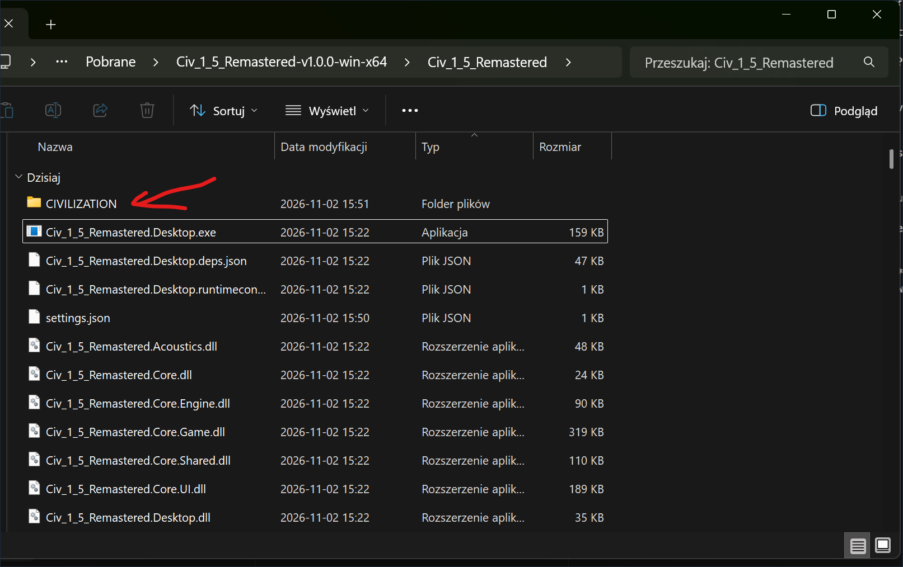
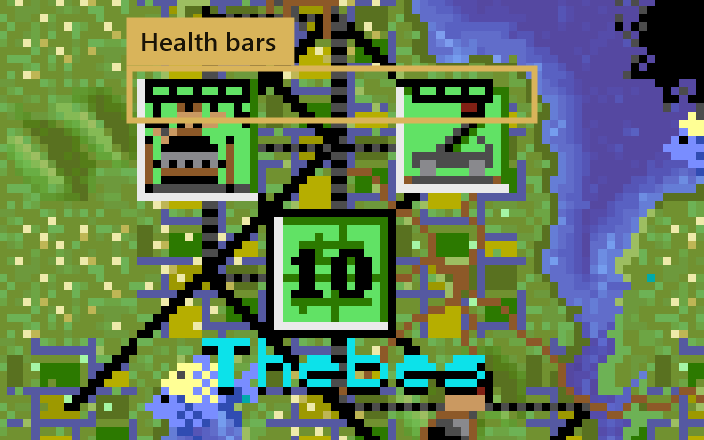
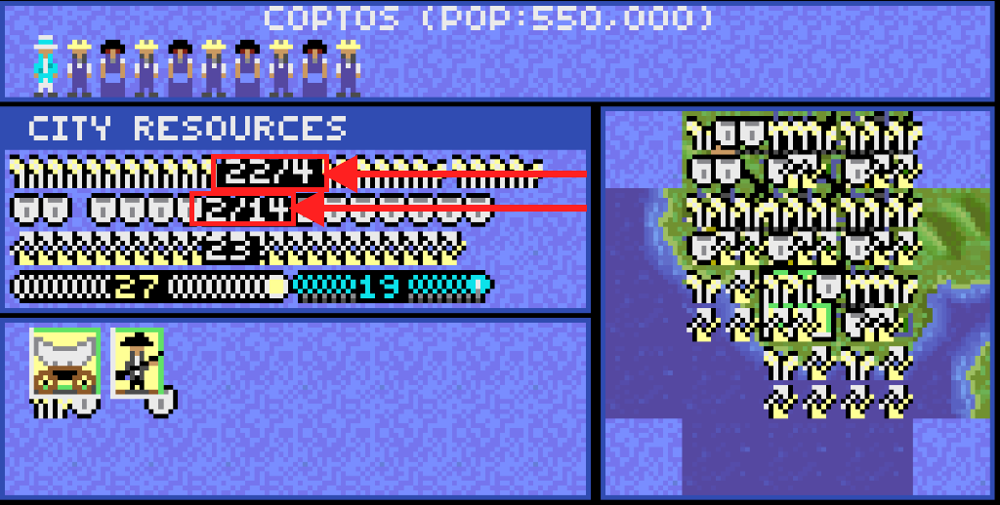
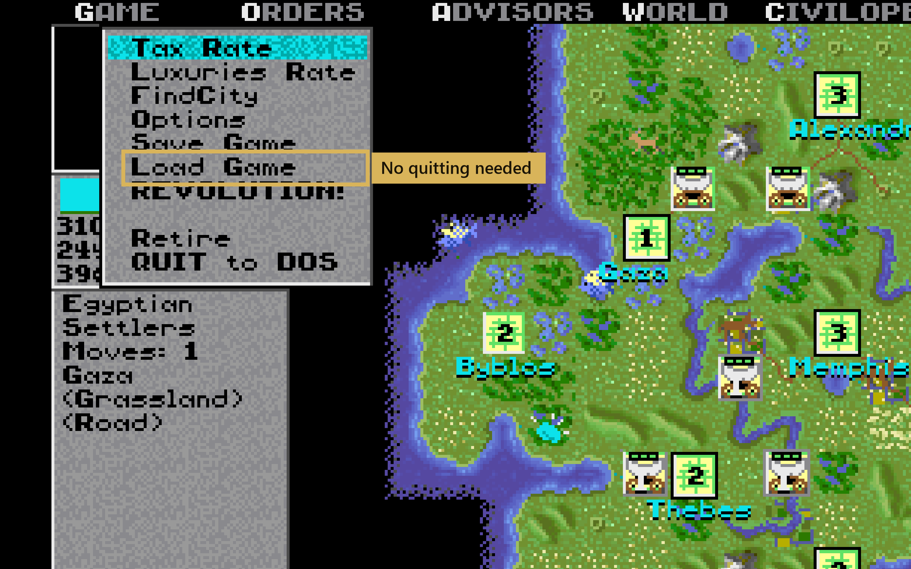
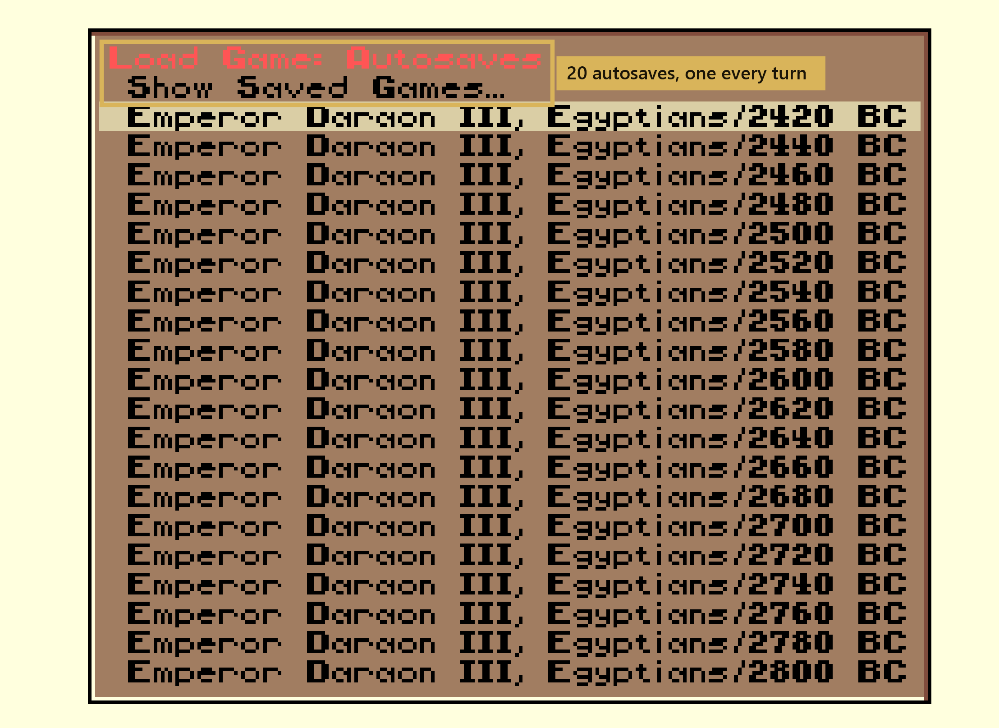

# Civ 1.5 Remastered

### 🌐 Oficjalna strona projektu:   [https://davit-futures.github.io/Civ_1_5_Remastered/pl/](https://davit-futures.github.io/Civ_1_5_Remastered/pl/)

 

  <a href="README.md">English</a> | <strong>Polski</strong>

  
  
  
  
  
  
  

**Aby zagrać:** rozpakuj [najnowsze wydanie](https://github.com/DavIT-Futures/Civ_1_5_Remastered/releases), umieść folder
`CIVILIZATION` obok `Civ_1_5_Remastered.Desktop.exe` (lub `Civ_1_5_Remastered.Desktop` na Linux/macOS) i uruchom grę. Folder `CIVILIZATION` to oryginalna
gra Civilization 1 dla DOS z 1991 roku. Nie jest częścią tego projektu, ale można ją łatwo znaleźć w sieci, na przykład na
Internet Archive: [wyszukaj "CIVILIZATION.zip Civilization 1991 DOS"](https://www.google.com/search?q=CIVILIZATION.zip+Civilization+1991+DOS+archive.org).

**Bez DOSBoksa i bez instalacji:** po prostu skopiuj folder z oryginalną grą obok programu, jak na zrzucie ekranu powyżej.

## Co nowego

Remaster w C# gry Civilization (1991) z DOS. Oryginalny plik `CIV.EXE` został przetłumaczony funkcja po funkcji na C#, dzięki czemu gra zachowuje pełen retro klimat, eliminując błędy i wprowadzając współczesne usprawnienia:

<table>
  <tr>
    <td align="center" width="50%">
      <a href="https://davit-futures.github.io/Civ_1_5_Remastered/pl/whats-new/#dlc-poland-japan">
        
         
        <strong>DLC: Polska i Japonia</strong>
      </a>
    </td>
    <td align="center" width="50%">
      <a href="https://davit-futures.github.io/Civ_1_5_Remastered/pl/whats-new/#unit-health">
        
         
        <strong>Paski zdrowia i walka</strong>
      </a>
    </td>
  </tr>
  <tr>
    <td align="center" width="50%">
      <a href="https://davit-futures.github.io/Civ_1_5_Remastered/pl/whats-new/#city-projects">
        
         
        <strong>Projekty miejskie i surowce</strong>
      </a>
    </td>
    <td align="center" width="50%">
      <a href="https://davit-futures.github.io/Civ_1_5_Remastered/pl/sound/">
        
         
        <strong>Osiem autentycznych trybów dźwięku</strong>
      </a>
    </td>
  </tr>
  <tr>
    <td align="center" width="50%">
      <a href="https://davit-futures.github.io/Civ_1_5_Remastered/pl/whats-new/#load-game">
        
         
        <strong>Wczytaj grę w menu</strong>
      </a>
    </td>
    <td align="center" width="50%">
      <a href="https://davit-futures.github.io/Civ_1_5_Remastered/pl/whats-new/#saves">
        
         
        <strong>Dwadzieścia slotów zapisu i autozapisy</strong>
      </a>
    </td>
  </tr>
</table>

👉 **[Zobacz pełną listę zmian na stronie Co nowego](https://davit-futures.github.io/Civ_1_5_Remastered/pl/whats-new/)** • **[Architektura dźwięku i sterowniki audio](https://davit-futures.github.io/Civ_1_5_Remastered/pl/sound/)** • **[Dokumentacja projektu](https://davit-futures.github.io/Civ_1_5_Remastered/pl/)**

## Jak zagrać

1. **Pobierz najnowszą wersję** dla swojego systemu operacyjnego:
   - [🪟 Windows (zip)](https://github.com/DavIT-Futures/Civ_1_5_Remastered/releases/latest/download/Civ_1_5_Remastered-win-x64.zip)
   - [🐧 Linux (tar.gz)](https://github.com/DavIT-Futures/Civ_1_5_Remastered/releases/latest/download/Civ_1_5_Remastered-linux-x64.tar.gz)
   - [🍏 macOS Apple Silicon (tar.gz)](https://github.com/DavIT-Futures/Civ_1_5_Remastered/releases/latest/download/Civ_1_5_Remastered-macos-arm64.tar.gz)
   - [🍏 macOS Intel (tar.gz)](https://github.com/DavIT-Futures/Civ_1_5_Remastered/releases/latest/download/Civ_1_5_Remastered-macos-x64.tar.gz)

   *(lub odwiedź [stronę Pobierz](https://davit-futures.github.io/Civ_1_5_Remastered/pl/download/) albo [Wydania GitHub](https://github.com/DavIT-Futures/Civ_1_5_Remastered/releases))*
2. Umieść pliki Civilization 1 dla DOS w folderze o nazwie `CIVILIZATION` obok `Civ_1_5_Remastered.Desktop.exe` (lub `Civ_1_5_Remastered.Desktop` na Linux/macOS).
   Pliki gry nie są częścią tego repozytorium; kopię znajdziesz np. wyszukując
   [CIVILIZATION.zip Civilization 1991 DOS](https://www.google.com/search?q=CIVILIZATION.zip+Civilization+1991+DOS+archive.org).
3. Uruchom `Civ_1_5_Remastered.Desktop.exe` (lub `./Civ_1_5_Remastered.Desktop` na Linux/macOS).

## Nota prawna

Civ 1.5 Remastered to nieoficjalny projekt fanowski. Nie jest w żaden sposób powiązany z firmami MicroProse, Firaxis Games ani Take-Two Interactive, ani przez nie zatwierdzony. Civilization jest zastrzeżonym znakiem towarowym odpowiednich właścicieli. Repozytorium nie zawiera żadnych plików oryginalnej gry. Kod projektu udostępniony jest na licencji MIT, patrz `LICENSE`.
